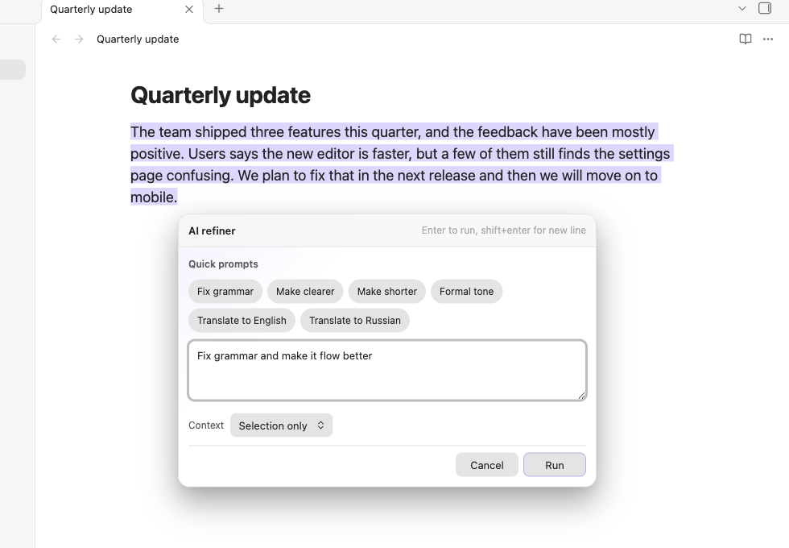
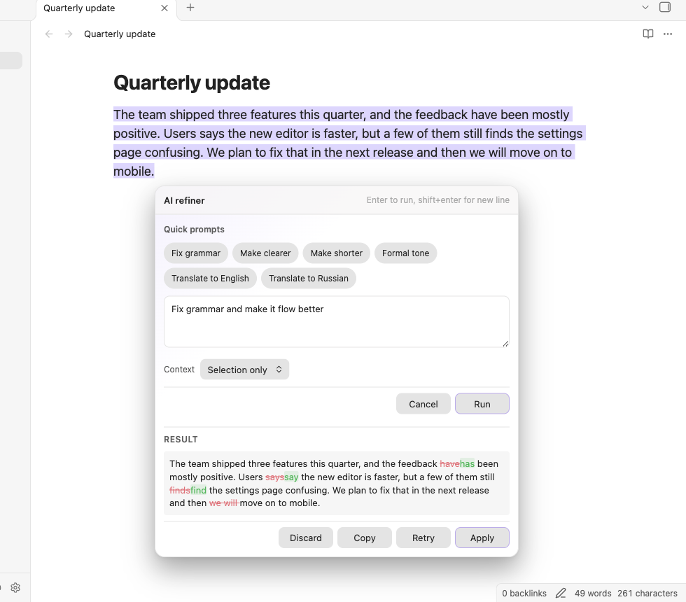

# AI Refiner

English: [README.md](./README.md)

Плагин для Obsidian, который правит выделенный текст прямо в заметке через плавающее
окно запроса. Выделите текст, опишите, как его изменить, и результат заменит выделение.

Работает с облачными API, локальными моделями и AI CLI: бэкенд выбираете вы, и ничто
не покидает ваш компьютер, пока вы сами этого не настроите.





## Возможности

- **Плавающее окно** рядом с курсором — введите инструкцию, нажмите Enter, готово.
- **Предпросмотр результата с diff** (по умолчанию) — исправленный текст показывается как
  пословный diff относительно вашего выделения с кнопками **Применить / Повторить /
  Копировать / Отклонить** (Apply / Retry / Copy / Discard), пока заметка не тронута.
  Нужно старое поведение? Переключите **Режим результата** (Result mode) на *Заменять
  сразу* (Replace immediately) в настройках (при обновлении со старых версий оно сохраняется).
- **Быстрые промпты** — «Исправить ошибки», «Сделать понятнее», «Сократить», «Формальный тон»,
  «Перевести на английский», «Перевести на русский» одним кликом; пресеты полностью
  редактируются, можно добавлять свои. К каждому промпту можно привязать свой провайдер
  и модель (например, гонять «Исправить ошибки» через быструю локальную модель, а всё
  остальное — через провайдера по умолчанию). Привязка действует, пока инструкция в
  панели совпадает с промптом; на мобильных привязка к CLI заменяется на API-провайдера.
- **Контекст** — по желанию можно отправлять окружающий абзац или всю заметку (для
  огромных заметок обрезается до окна вокруг выделения) как справочный материал только
  для чтения; заменяется всегда только выделение. Область выбирается прямо в панели.
- **Несколько бэкендов** через единый конвейер (см. таблицу ниже).
- **Три способа вызова**: палитра команд, иконка на ленте или собственная горячая клавиша.
- **Голосовой ввод** (по желанию) — диктуйте инструкцию через Whisper-совместимый
  эндпоинт распознавания речи (по умолчанию выключен).
- **Потоковый предпросмотр** — в режиме предпросмотра результат стримится в панель по
  мере генерации. Стриминг работает из коробки для эндпоинтов OpenAI, Anthropic,
  OpenRouter, Groq, Mistral, DeepSeek и xAI; локальные серверы (Ollama, LM Studio) стримят,
  если разрешают origin Obsidian (для Ollama задайте `OLLAMA_ORIGINS=app://obsidian.md*`),
  иначе плагин прозрачно переходит на буферизованные ответы.
- **Отмена на лету** — нажмите Escape. CLI-провайдеры реально завершаются (SIGTERM),
  стриминговые HTTP-запросы прерываются на лету. Только буферизованные (не стриминговые)
  HTTP-запросы просто отбрасывают результат: сетевой API Obsidian не умеет прервать уже
  отправленный запрос, так что сервер может дообработать его до конца.
- **Безопасная замена** — если документ изменился во время запроса, устаревший результат
  отбрасывается, а не затирает посторонний текст.
- **Локализация** интерфейса (английский, русский, испанский) по языку Obsidian.

## Провайдеры

| Провайдер | Тип | Платформа | Примечания |
| --- | --- | --- | --- |
| Custom API | Облако / self-hosted | Desktop + mobile | OpenAI-совместимые, Anthropic, Google Gemini, OpenRouter, Groq и подобные — определяются по URL эндпоинта. |
| Локальные модели | Локально | Desktop + mobile | Ollama и OpenAI-совместимые локальные серверы (LM Studio и т. д.). |
| Gemini CLI | Локальный CLI | Только desktop | Запускает Gemini CLI как дочерний процесс. |
| Codex CLI | Локальный CLI | Только desktop | Запускает Codex CLI как дочерний процесс. |

На мобильных CLI-провайдеры скрыты, и плагин автоматически переключается на API или
локальный провайдер.

## Установка

### Вручную (из релиза)

1. Скачайте `main.js`, `manifest.json` и `styles.css` из последнего релиза.
2. Скопируйте их в `<Vault>/.obsidian/plugins/ai-refiner/` вашего хранилища.
3. Перезапустите Obsidian и включите **AI Refiner** в **Settings → Community plugins**.

### Сборка из исходников

```bash
npm install
npm run build
```

Затем скопируйте получившиеся `main.js`, `manifest.json` и `styles.css` в папку плагина,
как выше, или воспользуйтесь deploy-скриптом:

```bash
OBSIDIAN_PLUGIN_DIR="$HOME/Obsidian/.obsidian/plugins/ai-refiner" npm run deploy
```

### Установка CLI-провайдеров (desktop)

CLI-провайдеры запускают **локально установленный** бинарник — сам плагин ничего не
скачивает и не исполняет удалённый код (поэтому пресета с `npx` нет: `npx -y` при каждом
запросе тянул бы пакет из реестра npm и запускал его). Установите нужный CLI один раз,
авторизуйтесь и укажите плагину путь к бинарнику:

- **Codex CLI**: `npm install -g @openai/codex` (или `brew install codex`), затем
  `codex login` в терминале. Исполняемый файл по умолчанию: `codex`.
- **Gemini CLI**: `npm install -g @google/gemini-cli` (или `brew install gemini-cli`),
  затем один раз запустите `gemini` для авторизации. Исполняемый файл по умолчанию: `gemini`.

Если голая команда не находится из Obsidian (GUI-приложения не наследуют PATH вашей
оболочки), плагин дополнительно проверяет типичные каталоги установки; иначе укажите
абсолютный путь в настройках (его покажет `which codex` / `which gemini`). Конфиги старых
версий плагина с пресетом `npx` автоматически мигрируют на голый бинарник.

## Использование

1. Выделите текст в заметке.
2. Вызовите AI Refiner через палитру команд (**Улучшить выделенный текст**), иконку на ленте
   или настроенную горячую клавишу.
3. Введите инструкцию (или выберите быстрый промпт) и нажмите Enter.
4. Исправленный текст заменит выделение. Escape в любой момент отменяет запрос.

## Настройки

- **Провайдер** — бэкенд, который выполняет правку.
- **Режим результата** — «Сначала предпросмотр» (с diff и кнопками «Применить» /
  «Повторить» / «Копировать» / «Отклонить») или «Заменять сразу».
- **Базовая инструкция** — необязательный текст, добавляемый перед каждым запросом.
- **Комбинация клавиш** — запись и включение собственной горячей клавиши.
- **Включить голосовой ввод** — включение кнопки микрофона и эндпоинт распознавания речи.
- **Быстрые промпты** — правка встроенных пресетов или добавление своих.
- **Поля конкретного провайдера**:
  - CLI: путь к исполняемому файлу, аргументы (JSON-массив), таймаут.
  - API / локальный: эндпоинт, модель (можно определить автоматически), токен (если нужен).

## Сетевая активность и приватность

Плагин обращается в сеть только к эндпоинтам, которые настроили **вы**. По умолчанию
ничего никуда не отправляется, телеметрии и аналитики нет вообще.

Что и куда отправляется:

- **API / локальные провайдеры** — выделенный текст и инструкция уходят на заданный вами
  URL. Если эндпоинту нужен ключ, он передаётся в заголовке запроса
  (`Authorization: Bearer …`, `x-api-key` или `x-goog-api-key`).
- **CLI-провайдеры** (только desktop) — текст и инструкция передаются процессу CLI через
  stdin. Что делает с ними сам инструмент (включая его собственные сетевые вызовы) —
  на совести этого инструмента, а не плагина.
- **Голосовой ввод** (по желанию) — записанное аудио отправляется на настроенный вами
  эндпоинт распознавания.
- **Определение моделей** (по желанию) — кнопка «Определить модели» запрашивает эндпоинт
  моделей у провайдера.

**Хранение токенов:** в Obsidian **1.11.4+** токены API и голосового ввода хранятся в
SecretStorage Obsidian (**Settings → Keychain**; с версии 1.11.5 шифруются связкой ключей
вашей ОС) и при первой загрузке автоматически переносятся из `data.json` — открытая копия
удаляется только после проверенной записи в связку ключей. Секреты связки ключей
**привязаны к устройству** и не синхронизируются: после синхронизации хранилища на новое
устройство токен нужно один раз ввести заново. В старых версиях Obsidian токены остаются
незашифрованными в `data.json` плагина — синхронизированное или забэкапленное хранилище
распространяет их, поэтому не делитесь этим файлом.

## Мобильные устройства

Плагин работает на мобильных. CLI-провайдерам нужны API Node/Electron, поэтому они только
для desktop; на мобильных используйте API или локальную модель.

## Разработка

```bash
npm install
npm run dev     # watch build
npm run build   # type-check + production bundle
npm run lint    # eslint (incl. obsidianmd rules)
npm test        # vitest unit tests for pure logic
```

Исходники лежат в `src/` и разложены по ответственности: `providers/` (стратегии
бэкендов), `services/` (поток правки), `ui/` (плавающее окно), `settings/`, `voice/`,
`i18n/` и `utils/`. Юнит-тесты чистой логики — в `tests/`.

## Выпуск релизов

Релизы автоматизированы в `.github/workflows/release.yml` и запускаются пушем тега,
**равного версии в манифесте** (без префикса `v` — `.npmrc` проекта задаёт
`tag-version-prefix=""`, так что `npm version` создаёт правильный тег независимо от вашей
глобальной конфигурации npm).

```bash
npm run build            # produce main.js
npm run release-check    # versions in sync, artifacts present, tag format
npm version patch        # or minor / major — bumps package.json + manifest.json,
                         # updates versions.json when minAppVersion changed,
                         # commits and creates the un-prefixed tag
git push && git push --tags
```

Workflow заново прогоняет lint, тесты, сборку и `release-check`, затем аттестует
происхождение сборки и прикрепляет `main.js`, `manifest.json` и `styles.css` к релизу
GitHub. Запись в `versions.json` добавляется только при смене `minAppVersion` — именно
эта карта отдаёт старым установкам Obsidian последний совместимый релиз.

## Лицензия

Распространяется по лицензии MIT. См. [LICENSE](LICENSE).
